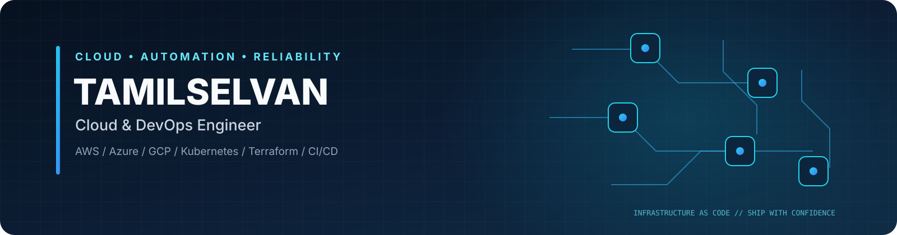

 

---

## About me

I'm **Tamilselvan**, a Cloud & DevOps Engineer with **4+ years of experience** working across AWS, Microsoft Azure, and Google Cloud in banking and e-commerce environments.

I enjoy building repeatable infrastructure and reliable delivery workflows with Infrastructure as Code, containers, Kubernetes, CI/CD automation, and observability. This profile brings together my hands-on projects, technical notes, and learning resources.

- ☁️ **Cloud:** AWS · Azure · Google Cloud
- ⚙️ **Platform & delivery:** Docker · Kubernetes · Helm · CI/CD
- 🏗️ **Infrastructure as Code:** Terraform
- 📊 **Observability:** Prometheus · Grafana
- 💻 **Tools & scripting:** Linux · Git · Bash · Node.js · Python

## Technology stack

**Cloud platforms**

**Containers and infrastructure**

**Automation and operations**

**Monitoring and development**

---

## Featured projects

<table>
  <tr>
    <td width="50%" valign="top">
      <h3>🛍️ ShopSphere · Microservices</h3>
      
A practical e-commerce project for exploring microservices, containerization, Kubernetes deployment, and application delivery.

      <a href="https://github.com/Cloud-Tamil/ShopSphere---Microservices-Application">Microservices application →</a> 
      <a href="https://github.com/Cloud-Tamil/shopsphere-helm-project">Helm deployment →</a>
    </td>
    <td width="50%" valign="top">
      <h3>📡 Fusion · Observability</h3>
      
An operations-focused project exploring service visibility, metrics, dashboards, and observability practices.

      <a href="https://github.com/Cloud-Tamil/Fusion-Microservices-Observability-Platform">Fusion Observability Platform →</a> 
      <a href="https://github.com/Cloud-Tamil/Observability-Project">Observability Project →</a>
    </td>
  </tr>
  <tr>
    <td width="50%" valign="top">
      <h3>🔁 GitHub Actions · CI/CD</h3>
      
Hands-on workflow examples and exercises for repository automation and continuous integration and delivery.

      <a href="https://github.com/Cloud-Tamil/GitHub-Actions-Learning-Project">Explore CI/CD project →</a>
    </td>
    <td width="50%" valign="top">
      <h3>🏗️ Terraform · Infrastructure as Code</h3>
      
Learning and provisioning resources focused on repeatable infrastructure definitions and change management.

      <a href="https://github.com/Cloud-Tamil/Terraform-Learning-Page">Terraform learning →</a> 
      <a href="https://github.com/Cloud-Tamil/Terraform-Deploy-Resources">Terraform resources →</a>
    </td>
  </tr>
</table>

Project scope and implementation status may vary. Check each repository's README for current features, prerequisites, and setup instructions.

## Learning resources

| Topic | Repository |
|---|---|
| AWS | [AWS Cloud Learning Path](https://github.com/Cloud-Tamil/AWS-Cloud-Learning-path) |
| Google Cloud | [GCP Cloud Learning Path](https://github.com/Cloud-Tamil/GCP-Cloud-Learning-path) |
| Kubernetes | [Traditional Kubernetes Installation Guide](https://github.com/Cloud-Tamil/Kubernetes_Installation_For_Traditional_Method) |
| Terraform | [Terraform Learning Page](https://github.com/Cloud-Tamil/Terraform-Learning-Page) |
| DevOps | [DevOps Learning Page](https://github.com/Cloud-Tamil/DevOps-Learning-Page) |
| Developer setup | [GitHub & VS Code Setup Guide](https://github.com/Cloud-Tamil/GitHub-VS-Code-Complete-Setup-Guide) |

## How I work

- **Automate first:** make recurring infrastructure and delivery tasks repeatable.
- **Design for operability:** consider health checks, logs, metrics, alerting, and troubleshooting.
- **Review changes:** use version control and inspect infrastructure plans before applying changes.
- **Keep security in mind:** use least privilege and never commit credentials or secrets.
- **Document for reuse:** capture setup steps, prerequisites, and useful lessons learned.

## GitHub activity

 

Activity cards are provided by third-party services and may occasionally be unavailable or rate-limited.

---

### Let's connect

Interested in cloud infrastructure, DevOps automation, Kubernetes, CI/CD, and observability.

<a href="https://www.linkedin.com/in/tamil8413/">LinkedIn</a> · <a href="https://github.com/Cloud-Tamil?tab=repositories">Explore all repositories</a>

